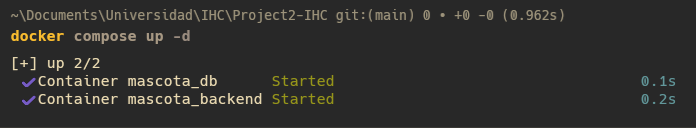
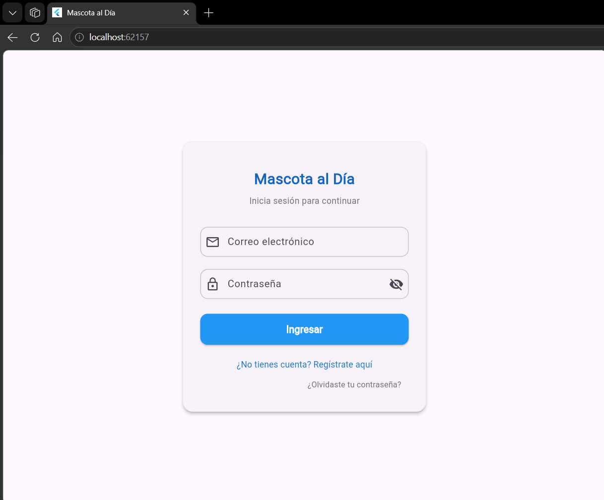

# Clase 17 · Análisis de proyecto recibido

## Proyecto recibido

Repositorio del grupo anterior:

https://github.com/GaboTex2004/Project2-IHC

El proyecto utiliza Flutter para el frontend y FastAPI para el backend.

## Ejecución

Para levantar backend y base de datos:

```bash
docker compose up --build
```

Para ejecutar la aplicación Flutter:

```bash
cd frontend
flutter pub get
flutter run
```

### Comando utilizado



### Aplicación funcionando



## Recorrido: pantalla → acción → regla → datos

### Pantalla

`frontend/lib/features/mascotas/screens/home_screen.dart`

Desde el panel de mascotas la persona puede marcar un cuidado como realizado y acceder posteriormente al historial.

### Acción

El frontend realiza:

```text
PUT /api/mascotas/{id}/completar
```

### Regla

`backend/mascotas/router.py`

La función `completar_cuidado` verifica que:

- el cuidado pertenece al usuario autenticado;
- el cuidado existe;
- no se encuentre ya realizado.

Si la acción es válida, cambia el estado del cuidado y genera un evento de historial.

### Datos

`backend/historial/models.py`

El evento queda persistido en la tabla `eventos` con el usuario, mascota, cuidado, tipo, detalle y fecha.

`backend/historial/router.py` consulta únicamente los eventos del usuario autenticado y los ordena del más reciente al más antiguo.

El frontend obtiene estos datos desde:

`frontend/lib/features/historial/services/historial_service.dart`

y los muestra en:

`frontend/lib/features/historial/screens/historial_screen.dart`

## Impacto para la Tarea 5

La especificación de la Tarea 5 no está incluida en el repositorio recibido. Según la estructura actual, una modificación de este recorrido podría requerir cambios en:

- las pantallas Flutter involucradas;
- los servicios HTTP del frontend;
- las reglas de los routers de FastAPI;
- los modelos o schemas si cambian los datos;
- las pruebas del backend relacionadas con la regla modificada.

Los principales archivos a revisar antes de implementar cambios son:

```text
frontend/lib/features/mascotas/screens/home_screen.dart
frontend/lib/features/historial/screens/historial_screen.dart
frontend/lib/features/historial/services/historial_service.dart
backend/mascotas/router.py
backend/historial/router.py
backend/historial/models.py
backend/tests/
```